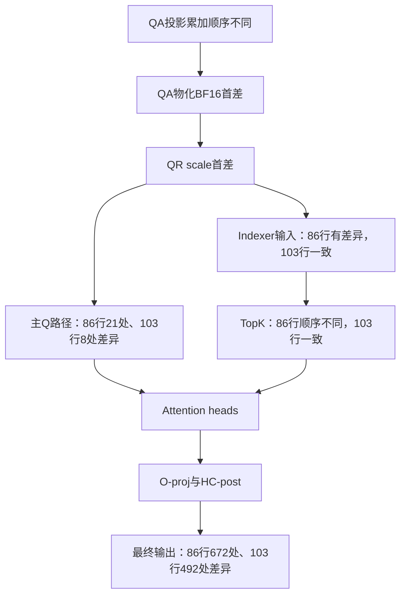

# T126 QA投影首差定位与修正记录

## 范围与基准

当前分支 `dev/pypto-dsv4-csa-nalinaly-tnd-20261008-codex`，起点
`c17805ed052c3c62f6be2d8ac5b53d4e8817201d`。原43项数学源、14项SPMD源和6项prepack源保持不变。
编译receipt保留历史SPMD祖先标记，BASELINE保留原43源参考；本轮实际源码以本报告所在提交和71源SHA为准。
诊断和候选独立保存；T126诊断候选已通过完整CSA单层门禁；正式无hook T126/T240及8K/128K整模型门禁均已通过。

测试使用真实模型第4层权重、合成hidden/history，history=8191，
请求长度`[1,2,3,4,5,6]×6`，36请求、实际T126。FULL graph使用126行，
不按请求补齐到216行。单层对拍不等同于整模型token验证。

## 原始问题

- 第86行TopK有28处顺序差异，集合相同；最终输出672处差异。
- 第103行TopK完全相同，最终输出492处差异，需独立追踪。
- 六类cache/state原生边界一致；未优化prepack对照复现同样问题。
- 有效观测器的Native/PTO各8外部边界均与原快照逐bit相同，观测本身不改变结果。

## 定位证据

| 检查 | 第86行 | 第103行 | 结论 |
| --- | --- | --- | --- |
| HC-pre、输入Norm、Indexer weights | 一致 | 一致 | 不在这些阶段引入 |
| QA物化BF16 | col484差1元素，绝对差2^-12 | col331差1元素，绝对差2^-13 | 当前最早观测首差 |
| QR INT8 | 一致 | 一致 | INT8结果一致不能证明scale一致 |
| QR FP32 scale | 差1元素 | 差1元素 | 由QA首差传播 |
| RoPE后Q | 21元素不同 | 8元素不同 | 主Q链误差传播 |
| Indexer Hadamard BF16 | 76元素不同 | 一致 | 两行需分别解释 |
| QLI query INT8 | 3元素不同 | 一致 | 第86行TopK输入已经不同 |

受控实验进一步排除了错误修复方向：

1. 将Native实际QLI输入交给原PTO打分/排序，126×512个TopK索引全部一致。
   本案例没有证据要求修改TopK打分或排序。Native该接口不支持返回score张量，
   此证据证明返回索引一致，不宣称所有内部score逐bit一致。
2. 将Native实际QA交给原PTO QR归一化/量化，全126行INT8和FP32 scale全部一致。
   因而先修QA投影，而非修改RMSNorm。
3. 同normalized hidden、同NZ29权重的Native `F.linear`，与FULL捕获的
   126×1024 QA全部逐bit一致；重复计算一致。独立投影参考入口有效。

## 单因素实验

所有实验使用同一份保存的实际Native输入/QA金值，检查NZ保真、输入/权重只读、
输出前后guard、shape/dtype与源码SHA。表中是BF16差异元素数，非最终输出误差。

| QA策略 | 全126×1024差异元素 | 第86行 | 第103行 | 是否采用 |
| --- | ---: | ---: | ---: | --- |
| 原实现 | 17 | 1 | 1 | 冻结对照 |
| 尾块改M64 | 17 | 1 | 1 | 否 |
| 扩大历史K-shift门到126 | 21 | 0 | 1 | 否 |
| 两者同时改变 | 21 | 0 | 1 | 否 |
| 实测包序，K256粒度 | 0 | 0 | 0 | 进入完整CSA验证 |
| 实测包序，K512粒度 | 0 | 0 | 0 | 独立佐证 |

Native有限抵消探针在44种循环/块序候选中唯一定位到按N96列组变化、行不变的顺序。
对前9组，K256块序为：`((group//2 + packet)%8)*2 + db%2`，
偶数组`packet=db//2`，奇数组`packet=7-db//2`；后续列组正序。
该探针不证明任意16!次序或硬件内部完整归约树。完整真实QA数值零差异是另一项必要证据。
修正应只新增T126分支，保留历史96/144/192/240等已验证档位的原规则。

## 完整候选验收顺序

独立候选`t126-qa-fixed-full-v1`只替换QA累加顺序。

1. 第86、103行16个内部阶段严格逐bit对拍。
2. 全126行8个外部输出/cache/state边界严格逐bit对拍。
3. 改变输入B，重新比较；恢复A，确认FULL replay实际读取新输入。
4. T126通过后，才验证T240，再做8K/B40、128K/B24整模型token。

每项NPU任务最大780秒，内部750秒；首差即停止扩大测试。
独立诊断候选已通过：第86、103行共32个stage比较全部逐bit一致，
全部126行8个A边界、8个B边界一致，Native/PTO两侧A恢复均通过。
Native原8输出仍与修正前金值一致。任务`task_20261020_102511_41212232918`退出0。

正式候选在BF16包新增`qkv_precision126.py`，只在`tile_rows==126`使用修正；
其他档位直接调用冻结的QA实现，旧96/144/192/240规则完整保留。
根入口的64参数及主体未改，仅换QKV模块导入。模型加载用的原reduction shim未改。
正式候选无hook的FULL A/B/A、跨bucket复测均已通过，随后完成8K和128K整模型复测。

## 正式候选无hook复核

最终格式化源码的8文件SHA与`bf16qa126-full-t126-v2`结果逐项相同。
T126的A/B八边界、A恢复、只读参数包、输出guard、跨bucket/跨stream80项检查均通过；
没有重新引入观测器，没有把Native运算接入PTO数学。旧8K/128K金值不会重跑Native2。

这里定位到的是我们的QA累加顺序与Native调度不一致，不能把原TopK顺序差异归因于Native排序bug。
第103行的独立输出误差同样由QA主Q路径传播，修正后heads、O-proj和最终输出均逐bit一致。



这是修正前观测到的传播链；修正QA顺序后上述两行阶段及全T126外部边界均exact。

T240、8K/B40、128K/B24均已通过各自门禁，验收范围以下表为准。

### T240跨bucket夹具的非数值失败

首个T240任务的A/B八边界及ABA均通过，但跨bucket准备断言未通过，不能计整体PASS。
原因是全S6主bucket的前6行，与同history的小bucket完全相同，未真正覆盖共享RoPE。
新独立夹具只将小bucket的history加1，保留严格的覆盖集合、共享storage和全部精度断言；
小bucket用自身新Native金值比较，主T240金值不变。CSA源码及误差容限未改。
此修正已独立审查，重跑任务单独记录。

### 最终源码FULL门禁

| 场景 | 物理图行数/真实行数 | A/B、ABA | 跨bucket/stream | 结论 |
| --- | --- | --- | --- | --- |
| 混合1～6行，36请求 | 126/126 | 全8边界逐bit一致 | 80项一致 | PASS |
| 均匀6行，40请求 | 240/240 | 全8边界逐bit一致 | history+1真实覆盖，80项一致 | PASS |

T240 v2使用同一8文件候选源码SHA，任务`task_20261020_104542_114787221439`退出0。
整模型快照保留3385个原文件，新增8文件，共3393文件/71个运行源；
其静态资格与计时观察器的11项CPU测试通过。8K无设备导入、工具链、权重、bank和Native gold预检通过。

## 真实整模型配置与结果

- 模型为本机完整`DeepSeek-V4-Flash-0731-w8a8`，75分片；vLLM 0.25.1、Torch 2.10.0+cpu、Torch-NPU 2.10.0.post2，CANN/ATB 9.2.0-beta.2。
- 16卡，TP=1、DP=EP=16，DSpark出5验6；确定性level=1、HCCL确定性开启，EPLB关闭。
- 固定Native前缀bank，公开40问及chat suffix按原方案核验；不声称前缀/cache字节与nalinaly原bank相同。
- 每请求warmup 192 token，再测3轮各192 token。8K每卡40请求、实测40活跃，FULL档6/240；128K每卡提交24请求，沿用21活跃的Native轨迹，FULL档6/144。
- 只替换21个CSA层的HC-pre至HC-post，20个HCA层保留Native；观测器核验实际单PTO根入口、64 tensor ABI，无静默回退。
- 复用已验收Native token/event金值及历史性能，不跑Native2；计时窗口无profile/内部hook，不包含首次编译。

8K任务`task_20261020_105106_138127124624`退出0，独立CPU审计通过：
16×40×192×4=491,520个token、105,152个接受事件全部与Native一致，零抢占；
请求、query bounds、positions、input IDs及DP图工作量与历史Native各轮一致。
每轮20个forward样本/19个cycle样本，按每步16 rank最大值再求均值。

| 场景 | token/event一致性 | 候选forward / ms | 历史Native / ms | 候选cycle / ms | 历史Native cycle / ms |
| --- | --- | ---: | ---: | ---: | ---: |
| 8K/B40 | 491,520 / 105,152，全一致 | 107.0902 | 89.4822 | 123.7709 | 105.5745 |
| 128K/B24 | 294,912 / 61,568，全一致 | 92.2142 | 79.7299 | 107.4091 | 92.2929 |

128K任务`task_20261020_110457_210356831916`退出0，独立CPU审计通过：
16×24×192×4=294,912个token、61,568个接受事件全部一致，零抢占。
计时窗口每卡21活跃请求、126真实query行、144图行；18行属于全图bucket padding，
真实不等长请求不补S6的验收见T126混合用例。
960组固定phase配对的CPU字段除call严格一致；
Native第一次阶段与候选第一次严格配对，后两轮与Native第二阶段配对。

8K原prepack版forward为106.7287 ms，本次107.0902 ms，没有证据表明整模型已有性能收益。
128K原prepack版forward/cycle为90.7607/103.1217 ms；本次也没有显示整模型性能收益。
本次两档forward分别比历史Native高19.68%/15.66%。
历史对照非同卡同时受控AB，不据此宣称小幅变化是稳定优化或回退，
也不能把候选整体差异单独归因于QA修正。该候选保持显式opt-in，原基准和默认路由不变。

## 复现方法

以下命令在227的`yejia`账户执行，复用本报告记录的隔离SDK、Native bank和模型权重。
使用本报告所在提交的源码，并先核对证据中的8文件SHA；环境或来源不符时停止。
复测必须用新case及新job名，禁止覆盖旧结果。源码、配置、完整金值和助手保存在本节末尾的证据包中。

### 1. 编译与单层FULL门禁

从`reproduction-tools.tar.gz`恢复助手到原实验根；从本提交同步候选包8个Python文件至
`$qa_exp/src/vllm_ascend/ops/pypto/deepseek_v4_flash_csa_tnd_precision_spmd_bf16layout/`。
原43/14/6源、SDK、Native helper路径必须与清单一致；不用pip重装。

```bash
qa_exp=/data/pyptouser/yejia/vllm-nalinaly-tnd-20261008-codex/precision-spmd-20261019
qa_python=/data/pyptouser/yejia/vllm-cann901-csa-0251rc1/env/bin/python
bash "$qa_exp/compile-full-bf16layout-qa126.sh"

qa_flags=(--device auto --max-time 780 --ptoas 0.63
  --env PYTHONNOUSERSITE=1
  --env ASCEND_HOME_PATH=/data/pyptouser/yejia/vllm-cann92-main/env/Ascend/cann-9.2.0-beta.2
  --env PTOAS_ROOT=/data/pyptouser/yejia/vllm-cann901-csa-0251rc1/experiments/nalinaly-71153bb3/reference-env/bin
  --env CCACHE_DIR=/data/pyptouser/yejia/vllm-cann901-csa-0251rc1/src/pypto/.ccache
  --env CMAKE_BUILD_PARALLEL_LEVEL=4)

task-submit "${qa_flags[@]}" \
  "bash $qa_exp/bf16layout-full-tools/run-full-csa.sh qa126-repro-t126-20261020 1,2,3,4,5,6,1,2,3,4,5,6,1,2,3,4,5,6,1,2,3,4,5,6,1,2,3,4,5,6,1,2,3,4,5,6 4 8191"
```

确认任务退出0、结果`complete/pass`为真、候选8源SHA正确、A/B/ABA和80个跨bucket检查全通过，
然后执行T240；发现首差立即停止，不继续大配置。

```bash
task-submit "${qa_flags[@]}" \
  "bash $qa_exp/bf16qa126-full-tools-v2/run-full-csa.sh qa126-repro-t240-20261020 6,6,6,6,6,6,6,6,6,6,6,6,6,6,6,6,6,6,6,6,6,6,6,6,6,6,6,6,6,6,6,6,6,6,6,6,6,6,6,6 4 8191"
```

T126/T240物理图行数必须分别为126/240，逐请求padding为0；不能用仅`running`或单个`ARM_PASS`判通过。
需要重做阶段定位时，使用归档中的`native_qa_order_probe.py`、`qa_variants_probe.py`、
`t126-qa-fixed-full-v1`观测根及对应编译器，依次核验实际Native QA金值、QA单因素和两行内部阶段。
带观测Native仍必须与冻结快照逐bit一致；观察器不能替代无hook验收。

### 2. 独立整模型复测

两个小层门禁通过后，以新目录绑定本次case。构建器检查实际lengths、layer、history、
真实/物理行数、padding、通过状态及候选源码，拒绝旧目录覆盖或来源不符。

```bash
PYTHONNOUSERSITE=1 TORCH_DEVICE_BACKEND_AUTOLOAD=0 "$qa_python" "$qa_exp/prepare_whole_bf16qa126.py" \
  --job-name whole-bf16qa126-repro-20261020 \
  --t126-case qa126-repro-t126-20261020 \
  --t240-case qa126-repro-t240-20261020
qa_job="$qa_exp/whole-bf16qa126-repro-20261020"
bash "$qa_job/preflight.sh" 8k
task-submit "${qa_flags[@]}" --device-num 16 "bash $qa_job/run-case.sh 8k pto"
```

8K任务退出0后，运行独立审计：

```bash
qa_manifest=$(sha256sum "$qa_job/snapshot/manifest.json" | cut -d ' ' -f 1)
PYTHONNOUSERSITE=1 TORCH_DEVICE_BACKEND_AUTOLOAD=0 PYTHONPATH="" "$qa_python" \
  "$qa_job/qualification-audit/independent8k.py" \
  --root "$qa_job/results/8k-pto" --identity qa126-repro-8k \
  --expected-source-manifest "$qa_manifest" --candidate-math "$qa_job/candidate-math.json" \
  --expected-file-count 3393 --expected-repeats 3 > "$qa_job/audit-8k.json"
```

审计应逐个token/event、全部rank和warmup/各轮读取原始JSON，并核验真实入口、实际工作量、零抢占。
只有审计通过，才继续：

```bash
bash "$qa_job/preflight.sh" 128k
task-submit "${qa_flags[@]}" --device-num 16 "bash $qa_job/run-case.sh 128k pto"
```

128K用`independent128k.py`同样审计，将root、identity及输出文件改成128K对应值，
另核验实际21并发、126真实行/144图行。固定C1-N1、C2/C3-N2配对仍要求全部CPU字段除call严格相同；
只有跨阶段观察记录比较允许已知的CPU槽0/-1哨兵差异。
不据此证明GPU padding内容或所有内部张量逐bit相同；最终token/event仍严格一致。
每次提交后持续查看`task-submit --status/--log`及rank日志，最终退出后才能归档。

归档器`pack_whole_bf16qa126_evidence.py 8k --job-name <新job名>`和对应`128k`命令
只打包文本结果、金值和源码，不包含权重/cache张量。精度范围限于报告实际测试，
不扩写为任意输入、任意CANN版本或所有内部logits逐bit一致。

## 本轮任务索引与归档

诊断开发失败单独记为ABI/编译/夹具问题，不当成模型数值失败；原失败记录保留。
所有NPU任务上限780秒、内部750秒，完整整模型任务约9分钟及9分半，均已退出。

| 任务ID（均为20261020） | 内容 | 状态/结论 |
| --- | --- | --- |
| `task_20261020_092412_35301310408` | packed-v1阶段观测 | 调度导出SSA作用域编译失败，未获得有效精度结果 |
| `task_20261020_092843_6040957925` | packed-v2阶段观测 | 原8边界不变，观测有效 |
| `task_20261020_093918_122603532181` | query-v3 | QR scale列宽1的DN加载不支持，非数值失败 |
| `task_20261020_094345_14657863315` | score-only-v1 | 输出别名声明缺失，非数值失败 |
| `task_20261020_094544_159862130952` | score-only有效版 | 同Native输入，126×512 TopK索引全一致 |
| `task_20261020_094731_17211668037` | query-v4 | QR scale首差，观察器不扰动原结果 |
| `task_20261020_095712_247130510505` | QA-v5 | QA为当前最早观测首差 |
| `task_20261020_100342_29960255301` | QR隔离-v1 | Out/InOut别名ABI不符，非数值失败 |
| `task_20261020_100636_322370123167` | QR隔离有效版 | 注入Native QA，全QR和scale一致 |
| `task_20261020_101110_346620229258` | 4个QA策略对拍 | 原17、M64尾块17、旧shift扩门21、组合21处差异 |
| `task_20261020_101520_367537828931` | Native QA次序探针 | 实际金值入口一致，有限候选序唯一定位 |
| `task_20261020_102106_3903994287` | 新次序QA对拍 | K256/K512两个版本均零差异 |
| `task_20261020_102511_41212232918` | QA修正完整观测根 | 两行32阶段、全126行A/B/ABA一致 |
| `task_20261020_103303_297892671` | 正式T126-v1 | 无hook FULL全部通过 |
| `task_20261020_103826_60881818757` | 正式T126-v2 | 最终格式化源码SHA对应FULL全部通过 |
| `task_20261020_104112_83744111619` | T240-v1 | A/B/ABA通过，RoPE覆盖夹具断言失败，整体不计通过 |
| `task_20261020_104542_114787221439` | T240-v2 | 真覆盖、FULL全部通过 |
| `task_20261020_105106_138127124624` | 8K/B40整模型 | 退出0，全部token/event及独立raw复算通过 |
| `task_20261020_110457_210356831916` | 128K/B24整模型 | 退出0，全部token/event及独立raw复算通过 |

快照构建器v1曾在复制已被helper清单复制的审计目录时停止，未占NPU；
v2新建独立目录，仅允许重复复制该目录内容，仍拒绝覆盖已有job根。
这不改变运行源、金值或精度断言。复现器后来增加新job/case参数，未修改本轮冻结快照。

独立复核从原始16个rank结果及Native金值重算全部token/event、源码和轨迹。
128K时延若逐样本先转ms再求均值，会相差1个FP64 ULP；按记录口径先聚合us再除1000，
得到与原摘要完全一致的92.21415227254231 ms。任何token、事件、轨迹或源码门禁均未放宽。

证据目录：[校验清单](evidence_tnd_precision/spmd_qa126_fix_20261020/manifest.json)、
[汇总](evidence_tnd_precision/spmd_qa126_fix_20261020/summary.json)、
[8K完整文本原始证据](evidence_tnd_precision/spmd_qa126_fix_20261020/whole-8k.tar.gz)、
[128K完整文本原始证据](evidence_tnd_precision/spmd_qa126_fix_20261020/whole-128k.tar.gz)、
[阶段定位与复现助手](evidence_tnd_precision/spmd_qa126_fix_20261020/reproduction-tools.tar.gz)。
同目录保存阶段结果、未采用策略、最终编译receipt及独立审查的gzip文件。
早期首差对照见[原T126失败报告](DSV4_FLASH_CSA_TND_PRECISION_SPMD_BF16_FULL_FIRST_DIFFERENCE_20261020.md)。

最终检查：私有QA路由及包装函数独立AST审查通过，11项观察器CPU测试通过；
无设备编译、真实kernel ABI、调度代码及加载期准备器通过，增量pre-commit含manual Markdown检查通过。
Gitleaks沿用本地环境约定跳过，未把该项报告为已执行。原63源与测试金值保持原SHA。
