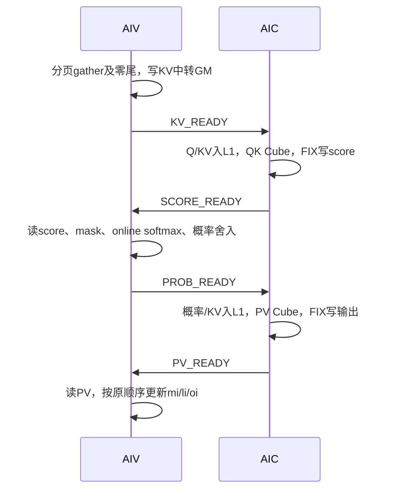

# TND精度版QK/PV测量与SWA优化（2026-10-19）

## 本轮目标

保持当前Native精度基准，先用相同输入分别观察Native、固定Nal性能BSH版和TND精度版的QK/PV工作量，再做一个可单独回退的优化。只有局部收益稳定且精度不变后，才复测真实整模型8K/B40与128K/B24的192token。

基准为 `1d6dbd027`。当前分支为 `dev/pypto-dsv4-csa-nalinaly-tnd-20261008-codex`。本轮不改PyPTO/Simpler/CANN或Native代码，不增加手写C++。

## 测量结论

现有kernel-mode FULL graph不能直接采集内部PMU，故另建program-mode诊断入口，保持原sparse helper计算，显式发布mi/li/oi和归一化BF16 heads；复用同一Native捕获输入和baseline FP32状态金值。实际收益另用关闭DFX/PMU的FULL graph验证。

Cube、Vector、Scalar及MTE忙碌计数可以重叠，不能相加为互斥耗时。当前接口没有精确逐事件等待周期，因此没有将total减busy后标成等待。Native用CANN采集，Nal核还包括inverse RoPE/发布，TND QK/PV核不包括；三者范围/采集模式不同，不能当统一性能排名。

### 保留的单因素

SWA只有最多128个真实Key，旧精度版却为512列数值块执行四片QK/PV。仅在SWA跳过第2～4片Cube计算，并显式构造score的正零尾。compressed路径不变。原K512 softmax块、实际K归约树、CAST_ROUND、PV累加与online状态更新顺序保持；跨核set/wait全保留。以SWA有效Cube片范围为单因素：AIC QK侧四片KV载入仍保留，PV随跳过片省略其对应的probability载入和part1的KV reload。本轮不是纯计算、其余搬运完全不变的ablation。

省略零项累加不自动保证所有浮点位相同，故不只验最终BF16：程序模式核对raw FP32 mi/li/oi全部字节，Graph又检查改输入、Q=0、ABA、NaN poison、guard和只读输入。

### 同卡交错局部实测

单位µs/完整sparse诊断root；每臂每任务20轮×100 replay；包括planner和统计/heads发布，不是单独QK/PV时间。

| 配置 | 重复 | 原版 | 优化 | 延迟下降 | 逐bit/其他门禁 |
| --- | --- | ---: | ---: | ---: | --- |
| 8K/B4/T24 | r1 | 236.487 | 217.648 | 7.97% | 71项通过 |
| 8K/B4/T24 | r2 | 227.034 | 219.317 | 3.40% | 71项通过 |
| 8K/B40/T240 | r1 | 963.384 | 881.135 | 8.54% | 71项通过 |
| 8K/B40/T240 | r2 | 978.618 | 908.281 | 7.19% | 71项通过 |

80个配对轮次均为正收益。B4两个任务在物理0卡，B40两个在物理1卡；跨任务基线漂移，不把两次降幅平均成固定收益。

### PMU如何解释收益

同bank的program-mode，单位为每core/task平均千cycles。TND原版→候选：Cube busy18.52→11.58、MTE1 busy21.69→13.56，各下降约37.5%，接近Nal的11.78/13.56；AIC total138.21→117.25、AIV total142.23→121.67。AIV Vector仍为35.32，Nal为21.11；MTE2也尚有差距。busy变化只用于诊断，不能将这些降幅替代生产Graph收益。

### 计算、搬运与等待的位置

下图只表示静态依赖，不按时间比例绘制。跨核事件全部保留。



PTO诊断PMU的每core平均千cycles如下；各pipeline并发，不能相加。

| 指标 | Nal性能BSH | TND原版 | SWA候选 |
| --- | ---: | ---: | ---: |
| AIC total | 78.44 | 138.21 | 117.25 |
| AIC Cube busy | 11.78 | 18.52 | 11.58 |
| AIC MTE1 busy | 13.56 | 21.69 | 13.56 |
| AIC MTE2 busy | 17.34 | 25.65 | 23.27 |
| AIC Scalar busy | 36.37 | 23.24 | 21.27 |
| AIV total | 87.89 | 142.23 | 121.67 |
| AIV Vector busy | 21.11 | 34.69 | 35.32 |
| AIV MTE2 busy | 24.09 | 22.52 | 21.42 |
| AIV MTE3 busy | 10.53 | 16.46 | 17.68 |
| AIV Scalar busy | 45.61 | 46.53 | 41.58 |

Native CANN实测SparseAttnSharedkv三次duration为55.760/55.800/55.040µs；CANN给出的忙碌占比另记：AIC Cube13.63%、MTE1 17.53%、MTE2 53.23%、Scalar57.20%；AIV Vector8.70%、MTE2 37.30%、MTE3 15.37%、Scalar43.10%。其总cycles均摊每core为AIC90.05k/AIV96.28k。没有原始busy cycles时保留百分比，不从舍入百分比或假定频率换算cycles；也不将这些跨采集模式数据作为严格速度比。

Nal测量用同bank，但heads relative L2为0.2544%，不满足本轮逐bit验收；其pass只表示测量程序完成。不能为了达到Nal的busy计数而照搬K128独立softmax/rint及online归并。

## 精度和覆盖

v1完整CSA Native/PTO在T1、混合1～6行T21、B40/T240均逐bit通过；T21实际21行，不按请求补S6。最终v2仅为concat表达式换行，完整AST相同，另用v2真实源重测混合T21通过。所有比较覆盖输出、六类cache/state、TopK，8边界A/B/ABA、防越界、实际PTO dispatch及62Tensor入口；无Native fallback。

本轮单层完整CSA的B40/T240为Native1.373ms、优化PTO2.295ms，仍有明显差距。这一结果不是整模型延迟，也不是与旧PTO同卡交错。

## 整模型结果

8K/B40已完成：192token预热+3次192token，16rank共491,520token与105,152接受事件全部等于Native，零抢占；全部21层CSA为PTO、20层HCA为Native，62Tensor入口，测量期间无编译/cache变更。960行候选CPU metadata对Native三窗严格仅排除call，2,880对全部一致。

| 真实模型档位 | Native历史Forward ms | V6旧精度版 ms | SWA精度版 ms | 相比V6观察到的下降 | token/接受事件 |
| --- | ---: | ---: | ---: | ---: | --- |
| 8K/B40 | 89.482 | 110.289 | 108.707 | 1.43% | 491,520 / 105,152，全一致 |
| 128K/B24（21活跃） | 79.730 | 92.389 | 91.659 | 0.79% | 294,912 / 61,568，全一致 |

8K cycle由125.910ms降为124.367ms（观察到1.23%下降）；历史Native为105.575ms。三次Forward分别108.566/108.741/108.813ms，旧V6为110.113/110.383/110.370ms。整模型均为跨时段历史窗对比；单独确认稳定方向的是上面的同卡交错局部测试。

8K整模型约降低1.582ms；局部B40 sparse下降70～82µs，按21个CSA层粗略换算约1.48～1.73ms，量级相符。这是说明收益为何较小的估算，不冒充21层实际独立阶段测量。

128K三轮全部通过严格阶段配对审计：294,912个token、61,568条接受事件全部等于Native，零抢占；21层CSA全部执行PTO。960行CPU metadata对所选Native阶段仅排除call逐字相同，保留input_ids_cpu，不归一化0/-1。candidate第1轮对Native第1窗，第2/3轮对Native第2窗；该policy及7项正负fixture沿用V6原字节。

完整cycle（每步16rank最大值，包含Forward以外的循环开销）必须同时报告：

| 档位 | Native历史cycle ms | V6旧精度版 ms | SWA精度版 ms | 相比V6观察结果 |
| --- | ---: | ---: | ---: | --- |
| 8K/B40 | 105.575 | 125.910 | 124.367 | 降1.23% |
| 128K/B24 | 92.293 | 104.724 | 105.617 | **增0.85%** |

128K三次Forward为91.911/91.259/91.805ms（V6为91.907/92.556/92.706）；三次cycle为104.410/108.226/104.216ms（V6为104.135/104.969/105.067）。候选cycle最大191.342ms、标准差11.585ms，V6最大106.314ms、标准差0.749ms。长尾位于第2轮cycle index4，全部16rank同一步为189.73～191.34ms，对应Forward为90.69～91.61ms；原因未确定。保留全部样本，不剔除该步，不以median替换mean。历史窗不构成单因素整模型因果证明，不能宣称整模型cycle普遍提速，也不能把0.79%单独认定为稳定端到端收益。

8K实际占卡12:09:00～12:18:00为540秒；128K为12:48:38～12:58:19共581秒。排队分别1207/1796秒，调度列表显示的是提交到结束而非占卡时长。两项均在780秒运行上限内。

## 可复现身份与限制

最终运行Sparse SHA：`248d8b11bb0a045f7863c0b264d962845dcabafa51cbf1e5fafee413fa8dc6d5`。
完整3365文件source manifest：`639b1280dc682dad23195509ddd51970d0d16da55fa11efa302e9edc97da7e03`。
43运行源中仅Sparse变化，其余42份及62Tensor根不变。

真实模型使用原公开40条输入及自行Native生成的固定prefix/cache银行，未证明与Nal原bank逐字节相同。TP1/DP=EP16、NZ2/SK0、deterministic1/HCCL true、EPLB关；接收步长3.8未强制。128K/B24按提交24、实际21并发口径，126有效token进入144图桶。保留真正TND和Native公共metadata/cache/connector；仅CSA替换，HCA和FFN仍Native。

性能与精度仅覆盖记录的有限输入、模型、版本、硬件和图配置；没有声称所有IEEE特殊值或任意模型都逐bit相同。原Native性能为历史窗；只有局部sparse A/B是同卡交错的受控收益证据。每项NPU任务上限780秒，未重跑整模型Native2。

## 复现方法

仓库工具 [prepare_tnd_precision_performance_repro.py](prepare_tnd_precision_performance_repro.py) 新增 `--profile swa128`；原v4/v6 profile保持。它仅准备目录，不提交NPU，不覆盖旧job。原V6基准及旧证据均保留，新任务在独立目录运行。

运行环境：Python3.12、Torch2.10.0+cpu、Torch-NPU2.10.0.post2、vLLM0.25.1、Ascend0.25.1rc1、CANN/ATB9.2.0-beta.2、PyPTO3e87a843、Simplera54c0509、实际PTOAS0.66。模型为DeepSeek-V4-Flash-0731-w8a8；原75分片保留227，不拷贝权重。本次未安装或重编框架。

先将本仓库工具用rsync上传到227自己的新目录，再在227执行（label/destination必须均未使用）：

```bash
BASE=/data/pyptouser/yejia/vllm-nalinaly-tnd-20261008-codex
EXP="$BASE/qkpv-measurement-20261019-codex"
NEW="$EXP/whole-swa-repro-a"
python3 "$EXP/repro-tools/prepare_tnd_precision_performance_repro.py" \
 --profile swa128 --reference-job "$EXP/whole-swa-cube-v2" \
 --destination "$NEW" --label repro-swa-20261019-a
export PERF_REPEATS=3
bash "$NEW/preflight.sh" 8k
bash "$NEW/preflight.sh" 128k
sha256sum "$NEW/helper-manifest.json" "$NEW/snapshot/manifest.json"
```

source保持639b128...，新helper因job路径重定位而改变；必须使用新helper实际SHA，不能沿用原7669087...。本次新标签prepare及8K无设备preflight已实际通过；原最终job的两档preflight也通过。不执行归档prepare_snapshot.py；模型、bank、SDK、Native黄金及静态13包仍依赖227原环境。本工具不是任意机器的离线安装包。

先8K，完成严格审计后再128K；一档一任务：

```bash
task-submit --device auto --device-num 16 --max-time 780 --ptoas 0.63 \
 --env PYTHONNOUSERSITE=1 --env PERF_REPEATS=3 \
 --env ASCEND_HOME_PATH=/data/pyptouser/yejia/vllm-cann92-main/env/Ascend/cann-9.2.0-beta.2 \
 --env PTOAS_ROOT=/data/pyptouser/yejia/vllm-cann901-csa-0251rc1/experiments/nalinaly-71153bb3/reference-env/bin \
 --env CCACHE_DIR=/data/pyptouser/yejia/vllm-cann901-csa-0251rc1/src/pypto/.ccache \
 --env CMAKE_BUILD_PARALLEL_LEVEL=4 \
 "bash $NEW/run-case.sh 8k pto"
```

完成exit0后，用 [V6复现说明](DSV4_FLASH_CSA_TND_PRECISION_PERFORMANCE_REPRO_20261019.md) 中的原CPU审计器：8K用independent8k.py，128K用independent128k_phase_matched.py；显式传入新root、candidate-math、repeats=3、expected-source-manifest=639b128...。完整命令如下：

```bash
AUDIT="$BASE/precision-overnight-20261019/whole-formal-v6-audit"
OUT=/data/pyptouser/yejia/lc128/perf-repro-swa-20261019-a
python3 "$AUDIT/independent8k.py" \
 --root "$OUT-8k-pto" --identity SWA-repro-a --repeats 3 \
 --expected-source-manifest 639b1280dc682dad23195509ddd51970d0d16da55fa11efa302e9edc97da7e03 \
 --candidate-math "$NEW/candidate-math.json" > "$NEW/independent8k.json"
```

只有8K审计退出0且pass=true才用同样task-submit选项提交 `bash $NEW/run-case.sh 128k pto`，仍max780。完成后将上面auditor改为independent128k_phase_matched.py、root改为$OUT-128k-pto、结果改为independent128k.json。审计器旁保留原phase-policy.json，不用会忽略input_ids的脚本。每轮Forward20步、cycle19步，以逐步16rank最大值汇总。原40题输入顺序、chat suffix、Native固定prefix/cache bank、资格与调度轨迹均须核对。

单层最终入口为 `$EXP/full-csa-gate-v2/run-csa.sh mixed21 1,2,3,4,5,6 4 8191`，必须在task-submit单卡、max780任务里执行。微测量的所有Python/shell助手、Native捕获bank配置、FP32统计金值收据、baseline/候选源及实际生成物均在下列micro归档；按原助手的manifest校验后使用新的输出目录，不覆盖原金值。PMU每进程只开一个窗口，与无DFX replay测速分开。需要原NPU张量bank的复现继续依赖227，本GitHub归档只含文本证据，不含权重或张量文件。

## 原始证据和回放检查

本目录 [current_full_precision证据](evidence_tnd_precision/current_full_precision/manifest.json) 为当前源绑定。旧manifest另存formal-v6-manifest.json，原V4/V6归档保留；所有新归档为UTF-8 JSON/CSV/源码/日志，无模型或.pt。

| 归档 | SHA256 |
| --- | --- |
| swa-cube128-v2-micro-and-pmu-raw.tar.gz | ceea0bbcdf7d4248caaa85d7cf45d49f0eafe3d1ffb3eb1e964a82d087adba7e |
| swa-cube128-v2-mixed21-raw.tar.gz | 7739c739ea58ab1c8c9bcfbfd865fc232aebe5bdc79810d5b2d9402c03afc432 |
| swa-cube128-v2-8k-whole-raw.tar.gz | 90cba701bddfd1e900b21a2b488d6ccf4fa4ce1854b64db79d8a8905aaa3d6ec |
| swa-cube128-v2-128k-whole-raw.tar.gz | 38dda2262706380880d3511cb9f3ee7164e6aec749288f5219872a48aa1b6eac |
| swa-cube128-v2-reference-phase-raw.tar.gz | a1bde180e36242c838ebb7e62c7b7f9cfa14d3839bf8345fb95e95a4c1112fcf |

micro归档先于整模型完成冻结，内含当时pending的过程清单只代表历史状态；整模型最终状态以两个whole归档及严格audit为准。v1单层历史和v2源身份分别保留，不把v1重标为v2。最终source manifest639b128...、candidate-math f8b4f7992966d338dc20318483d40b8fb1678274113154cb2f9f4beb118a93c2、helper manifest7669087a700325b00ab64e145470f1ecc1e770998510f6a0f567f4c9c2c646ab均由实际运行结果锁定。

增量CPU回放同时校验43运行源SHA、整模型原始token/事件、metadata phase正负fixture、helper/qualification、四项微基准全部71门禁、80配对样本、420个micro payload SHA及private/正式源AST等价。它验证记录完整性，不代替NPU数值执行。

测量期间的技术失败也保留：重复编译SSA使私有源SHA门禁拒绝、第二PMU窗口HAL共享内存注册错误、调度器附加device参数与初版parser不兼容、一次wrapper路径错误，均修正并独立重跑；没有将这些失败判成精度错误，也未删除有效首窗口结果。

## 结论

本次仅合入SWA无效Cube片跳过，保留原精度版基准和全部计算舍入边界。受控Sparse局部收益稳定，B40两次为7.19%～8.54%；8K/128K真实模型token和接受事件全部无回退。整模型仍慢于Native，128K cycle均值还增0.85%，后续性能工作不能据本轮宣称已经追平Nal或Native。下一候选应依据仍偏高的Vector/MTE2工作量继续拆分验证；精确同步等待周期仍受当前接口限制。

## 本次提交前检查

8个相关CPU文件共54项全部通过；增量pre-commit及Markdown检查通过，独立源码/证据/复现审查通过。CPU最初一次暴露旧KV生命周期测试误将新增PV外层if当成reload_if，已修正实际AST定位，同时增加SWA/ compressed guard与首片累加初始化检查；原容量与256-token槽位检查保留。该问题属于测试定位错误，未修改已验收的NPU算子字节或放宽精度门禁。本轮未宣称仓库全量CI通过。

两项整模型实际运行分别为540秒和581秒；所有本轮登记任务均已结束，没有残余排队或运行任务。
